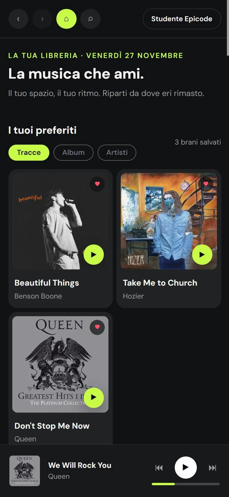

# EpiTunes

Clone di Spotify costruito sull'**iTunes Search API**, realizzato come Build Week 2 del percorso Front-End EPICODE.

L'applicazione cerca brani, album e artisti, riproduce le anteprime audio di 30 secondi e ricorda preferiti, cronologia, ultima ricerca e brano in riproduzione tra una pagina e l'altra.

**[Apri EpiTunes](https://alw4ystired.github.io/Build-Week-2-EpiTunes/)** — il sito è online, non serve installare niente.

---

## Anteprima

La home: nella sidebar brani, album e artisti preferiti in tre elenchi separati; al centro i preferiti con i filtri Tracce / Album / Artisti, la rotazione recente e i suggerimenti; in basso il player.


La ricerca interroga l'API mentre si digita e divide i risultati in brani, album e artisti.


Da telefono la sidebar lascia il posto alle icone nella topbar, e le card scendono a due per riga.



---

## Funzionalità

- **Ricerca** per brani, album e artisti, con le tre chiamate in parallelo
- **Player audio** nel footer: play, pausa, barra di avanzamento e volume trascinabili, mischia, precedente, successivo e ripeti
- **Coda di riproduzione**: l'elenco da cui hai fatto partire il brano — l'album, i risultati di ricerca, una riga della home, i preferiti — diventa la coda su cui si muovono precedente e successivo
- **La musica non si ferma cambiando pagina**: il player riprende dal secondo a cui era arrivato
- **Icona sincronizzata**: il brano in riproduzione mostra ⏸ sulla sua card e nella sidebar
- **Preferiti** salvati in locale, sincronizzati tra le card, la sidebar e le pagine album, artista e brano
- **Navigazione da telefono**: sotto i 576px la sidebar lascia il posto alle icone Home e Cerca nella topbar
- **Play rapido dalla sidebar**: passando sopra un preferito compare il bottone per farlo partire
- **Cronologia** degli ultimi brani ascoltati, mostrata in home
- **Pagina album** con copertina, dati dell'album e tracklist numerata
- **Pagina artista** con foto, genere e brani più ascoltati
- **Pagina brano**, raggiungibile cliccando la copertina in basso a sinistra nel player, con il **testo della canzone**
- **Frecce avanti e indietro** nella topbar, collegate alla cronologia del browser
- **Ultima ricerca** ripristinata alla riapertura della pagina Cerca

---

## Come aprire il progetto

Per usarlo basta aprire il [sito pubblicato](https://alw4ystired.github.io/Build-Week-2-EpiTunes/): non serve scaricare niente.

Per lavorarci sopra non serve nessuna build, ma serve un **server locale**: le pagine caricano i JavaScript come moduli ES (`type="module"`), che il browser rifiuta di eseguire aprendo il file con doppio click.

In VS Code, estensione **Live Server** e poi "Open with Live Server" su `index.html`.

Dipendenze esterne: Bootstrap 5.3.9 da CDN, l'iTunes Search API, TheAudioDB per le foto degli artisti e LRCLIB per i testi delle canzoni. Nessuna chiave a pagamento: TheAudioDB usa quella gratuita di prova, LRCLIB non ne vuole nessuna.

---

## Struttura

```
index.html        Home
search.html       Cerca
album.html        Dettaglio album   (album.html?id=...)
artist.html       Dettaglio artista (artist.html?id=...)
track.html        Dettaglio brano   (track.html?id=...)
assets/
  css/app.css     Tutti gli stili
  img/            Logo e immagini del README
  js/
    common.js     Base condivisa: importata da tutte le pagine
    home.js       Home
    search.js     Ricerca
    album.js      Dettaglio album
    artist.js     Dettaglio artista
    track.js      Dettaglio brano
```

---

## Architettura

Ogni pagina ha un suo file JavaScript che importa quello che gli serve da `common.js`. Tutto ciò che è comune a più pagine sta lì, e viene scritto una volta sola.

Ogni file di pagina comincia con `INIT_PAGE(...)`, che costruisce la sidebar e le icone di navigazione da telefono, collega le frecce avanti e indietro, monta il player nel footer e restituisce l'istanza del Player da usare per la riproduzione.

### Cosa esporta `common.js`

**Helper**

| | |
|---|---|
| `creaElemento(tag, classe, genitore, testo, id)` | crea un elemento del DOM e lo attacca al genitore |
| `FETCH_JSON(url)` | fetch con `try/catch` e controllo di `response.ok`: in caso di errore restituisce `{ results: [] }` invece di lanciare, così le pagine non devono gestirlo |
| `BIG_ART(url)` | trasforma la copertina da 100x100 a 600x600 |
| `FORMAT_TIME(ms)` | millisecondi in `m:ss` |
| `DEBOUNCE(fn, ms)` | rimanda l'esecuzione: usato dalla ricerca mentre si digita |
| `CERCA_INFO_ARTISTA(nome)` | foto e follower da TheAudioDB, con una memoria che evita di richiedere due volte lo stesso artista |

**Classi**

`Track`, `Album` e `Artist` trasformano la risposta grezza dell'API in oggetti con nomi leggibili. Ogni `Track` porta con sé `id`, `title`, `artist`, `artistId`, `album`, `albumId`, `cover`, `previewUrl` e `durationMs`: è l'unico formato che circola nel progetto, dal risultato di ricerca fino al localStorage.

`Player` gestisce l'elemento `<audio>` e il footer. I riferimenti agli elementi del footer vengono raccolti alla fine di `mount()` e non nel costruttore, perché `INIT_PAGE` crea il Player **prima** di montarlo: alla costruzione quegli elementi non esistono ancora.

**localStorage**

Brani: `GET_HISTORY`, `ADD_TO_HISTORY`, `GET_FAVOURITES`, `IS_FAVOURITE`, `TOGGLE_FAVOURITE`.

Album: `GET_FAV_ALBUMS`, `IS_FAV_ALBUM`, `TOGGLE_FAV_ALBUM`. Artisti: `GET_FAV_ARTISTS`, `IS_FAV_ARTIST`, `TOGGLE_FAV_ARTIST`. Stessa forma delle tre per i brani, ma su chiavi separate: aggiungere album e artisti non ha toccato i preferiti già salvati.

**Render e avvio**

`RENDER_SIDEBAR_FAVS` ridisegna la lista dei preferiti in sidebar, e va richiamata dopo ogni `TOGGLE_FAVOURITE`. `AGGIORNA_CARD_PLAY` rimette l'icona giusta — ▶ o ⏸ — sul pulsante verde di ogni card, e va richiamata dopo aver disegnato card nuove. `INIT_PAGE(paginaAttiva)` avvia la pagina.

**Costanti**

`API_BASE` e `STORAGE_KEY_LAST_SEARCH`.

---

## Dati salvati in locale

| chiave | contenuto |
|---|---|
| `epitunes_history` | ultimi brani ascoltati, massimo 12, dal più recente |
| `epitunes_favourites` | brani messi tra i preferiti |
| `epitunes_fav_albums` | album salvati |
| `epitunes_fav_artists` | artisti seguiti |
| `epitunes_last_search` | ultimo termine cercato, salvato solo a ricerca riuscita |
| `epitunes_player` | brano in riproduzione, secondo raggiunto e se stava suonando |
| `epitunes_volume` | livello del volume, scritto a fine trascinamento |

In `epitunes_history` e `epitunes_favourites` viene salvato l'oggetto `Track` intero, non il solo id: così la home può ricostruire le card senza richiamare l'API. Stessa cosa per gli oggetti `Album` e `Artist` nelle due chiavi dei preferiti per tipo.

`epitunes_player` viene scritto quando si lascia la pagina (evento `pagehide`) e riletto alla fine di `mount()`. È quello che permette alla musica di non interrompersi passando da una pagina all'altra.

---

## Scelte tecniche

- **Niente `innerHTML`.** Tutto il DOM è costruito con `createElement` e `textContent`, attraverso `creaElemento`. È un vincolo del corso ed è rispettato in tutti i file.
- **Moduli ES.** Ogni pagina importa solo le funzioni che usa davvero, così si vede a colpo d'occhio da cosa dipende.
- **Un solo punto per gli errori di rete.** Tutte le chiamate passano da `FETCH_JSON`: la gestione degli errori sta lì, non ripetuta in ogni pagina.
- **Anteprime da 30 secondi.** L'API non restituisce i brani interi: `durationMs` è la durata del brano completo, la riproduzione dura 30 secondi. Nelle tracklist mostriamo `durationMs`, che è la durata vera del brano; nel player invece il tempo totale arriva dall'elemento `<audio>` appena il file è caricato, così dice 0:30 e non 5:55.
- **Grafica sulle classi di Bootstrap.** Disposizione, spaziature, dimensioni del testo e comportamento responsive stanno nelle classi applicate a HTML e JavaScript. In `app.css` resta solo ciò che Bootstrap non ha: i colori della palette, le misure fuori scala, gli stati `:hover` e lo scheletro a griglia delle tre zone.
- **Un foglio di stile per zone.** `app.css` è scritto con il nesting nativo del CSS: ogni macro sezione — sidebar, topbar, card, hero, tracklist, player — è un blocco unico con dentro i suoi pezzi. Le media query stanno tutte in fondo.
- **Seconda API solo dove serve.** iTunes non restituisce le foto degli artisti: quelle arrivano da TheAudioDB, chiamato dalla pagina artista e dalle card artista della ricerca. La chiave gratuita regge 30 richieste al minuto, quindi le risposte restano in memoria finché si sta sulla pagina; se il limite viene superato le card ripiegano sull'icona del microfono e la pagina non si rompe.
- **Terza API per i testi.** I testi arrivano da LRCLIB, che non chiede nessuna chiave. La pagina del brano prova prima la corrispondenza esatta su titolo e artista, e se non la trova ripiega su una ricerca; quando il testo non c'è, al suo posto resta un messaggio e il resto della pagina funziona lo stesso.

---

## Team

| | |
|---|---|
| **Sandro** | team leader — `home.js`: preferiti in tempo reale e redesign della home — barre di avanzamento e volume trascinabili, play rapido nella sidebar, pagina brano, riproduzione che continua fra le pagine |
| **Emanuel** | `common.js`: fetch, classi, localStorage, sidebar preferiti, player — coda di riproduzione e i quattro bottoni del player — rifacimento della grafica: disposizione, spaziature e responsive di tutte le pagine portati sulle classi di Bootstrap, `app.css` riscritto per zone — `README.md` |
| **Alessandro** | `album.js` e `artist.js`: pagine album e artista — layout delle pagine con Bootstrap — foto degli artisti da TheAudioDB, testi delle canzoni da LRCLIB, frecce avanti e indietro, preferiti divisi per brani album e artisti |
| **Gabriele** | `home.js`: suggerimenti, preferiti e riprodotti di recente |
| **Davide** | `search.js`: ricerca di brani, album e artisti |

---

## Trello

Le attività sono distribuite per giorno sulla bacheca del gruppo, dove vengono annotati anche i bug trovati durante le prove.

[Bacheca Build Week 2 — Team 2](https://trello.com/b/3LmJ1arr/build-week-2-team-2)


## Stato

### Fatto

- [x] Setup: struttura in `assets/`, percorsi allineati su tutte le pagine
- [x] Base condivisa: `FETCH_JSON` con gestione errori, classi `Track` / `Album` / `Artist`
- [x] Dati in locale: cronologia, preferiti, ultima ricerca
- [x] Ricerca di brani, album e artisti con le tre chiamate in parallelo
- [x] Sidebar con l'elenco dei preferiti
- [x] Player audio: play, pausa, barra di avanzamento e volume
- [x] Bottoni del player: mischia, precedente, successivo e ripeti
- [x] Home: suggerimenti, preferiti e riprodotti di recente
- [x] Pagina album con tracklist e cuori sincronizzati
- [x] Pagina artista
- [x] Adattamento mobile-first dei breakpoint
- [x] Grafica portata sulle classi di Bootstrap e `app.css` riscritto per zone
- [x] Tempo totale del player preso dalla durata vera dell'anteprima
- [x] Home: suggerimenti a 6 card, una riga piena della griglia
- [x] Event delegation sulle griglie: un ascoltatore per griglia invece di tre per card
- [x] README con architettura, scelte tecniche e stato
- [x] Pubblicazione su GitHub Pages

### Extra

Cose che vanno oltre il minimo. Le spuntate sono già nel progetto, le altre sono decise ma non ancora iniziate.

- [x] **Foto degli artisti** da una seconda API: iTunes non le fornisce
- [x] **Frecce avanti e indietro** nella topbar, collegate alla cronologia del browser, che si disattivano da sole quando non c'è dove andare
- [x] **Play rapido dalla sidebar**: il bottone che compare passando sopra un preferito
- [x] **Barre trascinabili**: avanzamento e volume si prendono col mouse, non solo si cliccano
- [x] **Pagina del brano**: cliccando la copertina in basso a sinistra nel player si apre `track.html`, con copertina grande, album, anno, genere, durata e i comandi play e preferito
- [x] **Riproduzione continua fra le pagine**: il brano e il secondo raggiunto vengono salvati uscendo dalla pagina e ripresi in quella dopo. Se il browser blocca la ripartenza automatica il player resta in pausa e basta un click
- [x] **Navigazione da telefono**: sotto i 576px la sidebar sparisce, e Home e Cerca compaiono come icone nella topbar
- [x] **Testi delle canzoni** da una terza API, LRCLIB: nella pagina del brano scorrono in un riquadro, con la riga al centro accesa e le altre smorzate
- [ ] **Playlist**: pagina `playlist.html` con il suo `playlist.js`, per raccogliere i brani in elenchi creati dall'utente
- [x] **Preferiti divisi per tipo**: brani, album e artisti in tre elenchi separati, con "+ Salva album" nella pagina album e "Segui" in quella artista
- [ ] **Ricerche recenti** in un menu a tendina sulla casella di ricerca: oggi viene conservata solo l'ultima, e viene ripristinata all'apertura della pagina
