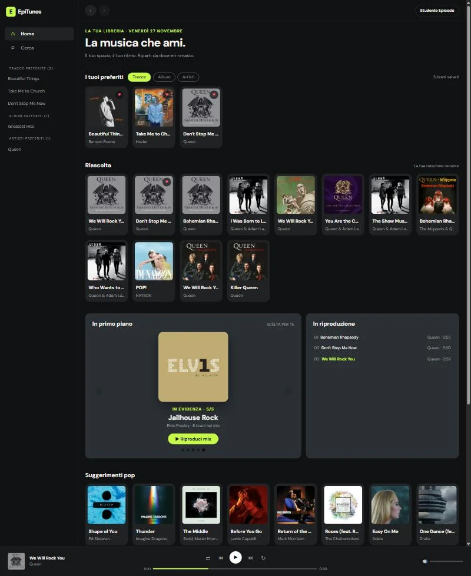
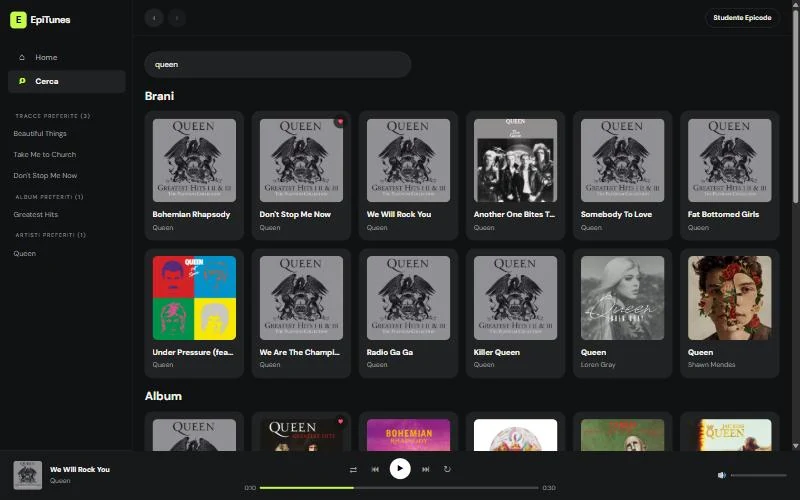
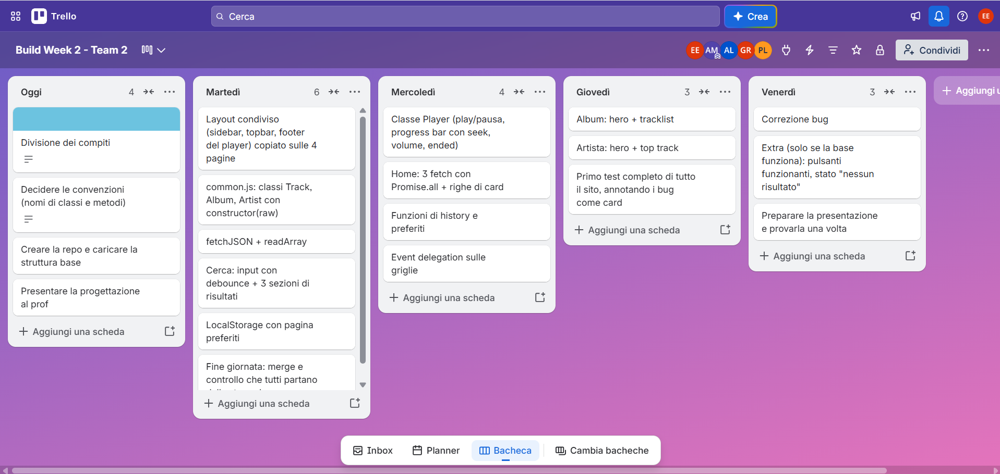

# EpiTunes

Clone di Spotify costruito sull'**iTunes Search API**, realizzato come Build Week 2 del percorso Front-End EPICODE.

L'applicazione cerca brani, album e artisti, riproduce le anteprime audio di 30 secondi e ricorda preferiti, cronologia e ultima ricerca tra una sessione e l'altra.

---

## Anteprima

La home: i preferiti in sidebar, le righe di suggerimenti e il player in riproduzione.



La ricerca, che interroga l'API mentre si digita e divide i risultati in brani, album e artisti.



---

## Funzionalità

- **Ricerca** per brani, album e artisti, con le tre chiamate in parallelo
- **Player audio** nel footer: play, pausa, barra di avanzamento cliccabile, volume
- **Preferiti** salvati in locale, sincronizzati tra le card, la sidebar e la pagina album
- **Cronologia** degli ultimi brani ascoltati, mostrata in home
- **Pagina album** con copertina, dati dell'album e tracklist numerata
- **Ultima ricerca** ripristinata alla riapertura della pagina Cerca

---

## Come aprire il progetto

Non serve nessuna build e nessuna installazione. Serve però un **server locale**: le pagine caricano i JavaScript come moduli ES (`type="module"`), che il browser rifiuta di eseguire aprendo il file con doppio click.

In VS Code, estensione **Live Server** e poi "Open with Live Server" su `index.html`.

Dipendenze esterne: Bootstrap 5.3.9 da CDN e l'iTunes Search API. Nessuna chiave API richiesta.

---

## Struttura

```
index.html        Home
search.html       Cerca
album.html        Dettaglio album   (album.html?id=...)
artist.html       Dettaglio artista (artist.html?id=...)
assets/
  css/app.css     Tutti gli stili
  img/            Logo
  js/
    common.js     Base condivisa: importata da tutte le pagine
    home.js       Home
    search.js     Ricerca
    album.js      Dettaglio album
    artist.js     Dettaglio artista
```

---

## Architettura

Ogni pagina ha un suo file JavaScript che importa quello che gli serve da `common.js`. Tutto ciò che è comune a più pagine sta lì, e viene scritto una volta sola.

Ogni file di pagina comincia con `initPage(...)`, che costruisce la sidebar, monta il player nel footer e restituisce l'istanza del Player da usare per la riproduzione.

### Cosa esporta `common.js`

**Helper**

| | |
|---|---|
| `creaElemento(tag, classe, genitore, testo, id)` | crea un elemento del DOM e lo attacca al genitore |
| `fetchJSON(url)` | fetch con `try/catch` e controllo di `response.ok`: in caso di errore restituisce `{ results: [] }` invece di lanciare, così le pagine non devono gestirlo |
| `bigArt(url)` | trasforma la copertina da 100x100 a 600x600 |
| `formatTime(ms)` | millisecondi in `m:ss` |
| `debounce(fn, ms)` | rimanda l'esecuzione: usato dalla ricerca mentre si digita |

**Classi**

`Track`, `Album` e `Artist` trasformano la risposta grezza dell'API in oggetti con nomi leggibili. Ogni `Track` porta con sé `id`, `title`, `artist`, `artistId`, `album`, `albumId`, `cover`, `previewUrl` e `durationMs`: è l'unico formato che circola nel progetto, dal risultato di ricerca fino al localStorage.

`Player` gestisce l'elemento `<audio>` e il footer. I riferimenti agli elementi del footer vengono raccolti alla fine di `mount()` e non nel costruttore, perché `initPage` crea il Player **prima** di montarlo: alla costruzione quegli elementi non esistono ancora.

**localStorage**

`getHistory`, `addToHistory`, `getFavourites`, `isFavourite`, `toggleFavourite`.

**Render e avvio**

`renderSidebarFavs` ridisegna la lista dei preferiti in sidebar, e va richiamata dopo ogni `toggleFavourite`. `initPage(paginaAttiva)` avvia la pagina.

---

## Dati salvati in locale

| chiave | contenuto |
|---|---|
| `epitunes_history` | ultimi brani ascoltati, massimo 12, dal più recente |
| `epitunes_favourites` | brani messi tra i preferiti |
| `epitunes_last_search` | ultimo termine cercato, salvato solo a ricerca riuscita |

Nelle prime due viene salvato l'oggetto `Track` intero, non il solo id: così la home può ricostruire le card senza richiamare l'API.

---

## Scelte tecniche

- **Niente `innerHTML`.** Tutto il DOM è costruito con `createElement` e `textContent`, attraverso `creaElemento`. È un vincolo del corso ed è rispettato in tutti i file.
- **Moduli ES.** Ogni pagina importa solo le funzioni che usa davvero, così si vede a colpo d'occhio da cosa dipende.
- **Un solo punto per gli errori di rete.** Tutte le chiamate passano da `fetchJSON`: la gestione degli errori sta lì, non ripetuta in ogni pagina.
- **Anteprime da 30 secondi.** L'API non restituisce i brani interi: `durationMs` è la durata del brano completo, la riproduzione dura 30 secondi.

---

## Team

| | |
|---|---|
| **Sandro** | team leader — `home.js`: aggiornamento dei preferiti in tempo reale |
| **Emanuel** | `common.js`: fetch, classi, localStorage, sidebar preferiti, player — `README.md` |
| **Alessandro** | `album.js`: pagina album — layout delle pagine con Bootstrap |
| **Gabriele** | `home.js`: suggerimenti, preferiti e riprodotti di recente |
| **Davide** | `search.js`: ricerca di brani, album e artisti |

---

## Trello

Le attività sono distribuite per giorno sulla bacheca del gruppo, dove vengono annotati anche i bug trovati durante le prove.

[Bacheca Build Week 2 — Team 2](https://trello.com/b/3LmJ1arr/build-week-2-team-2)



## Stato

- [x] Setup: struttura in `assets/`, percorsi allineati su tutte le pagine
- [x] Base condivisa: `fetchJSON` con gestione errori, classi `Track` / `Album` / `Artist`
- [x] Dati in locale: cronologia, preferiti, ultima ricerca
- [x] Ricerca di brani, album e artisti con le tre chiamate in parallelo
- [x] Sidebar con l'elenco dei preferiti
- [x] Player audio: play, pausa, barra di avanzamento, volume
- [x] Home: suggerimenti, preferiti e riprodotti di recente
- [x] Pagina album con tracklist e cuori sincronizzati
- [ ] Pagina artista
- [ ] Adattamento mobile-first dei breakpoint
- [ ] Home: suggerimenti a 12 card
- [ ] Pubblicazione su GitHub Pages
